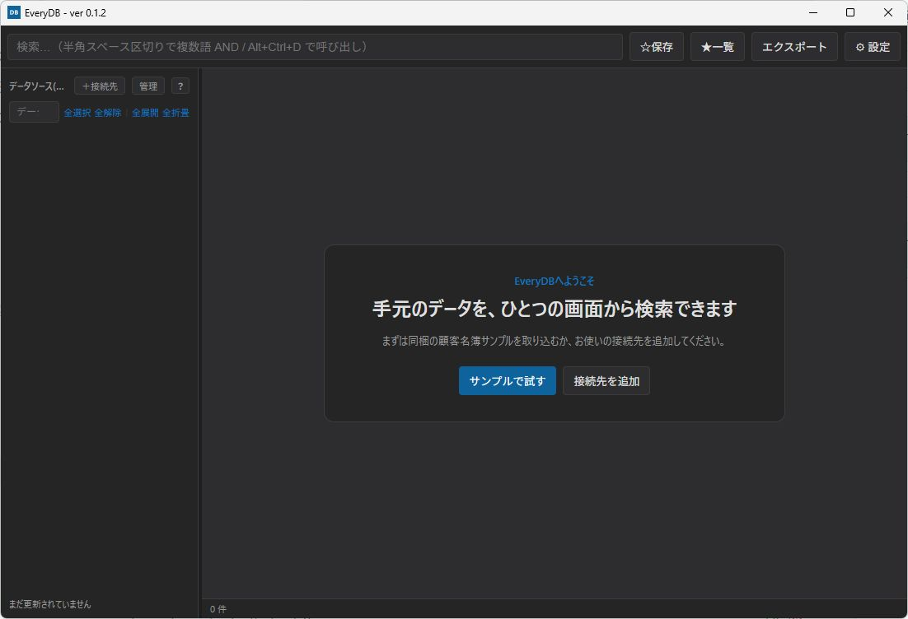
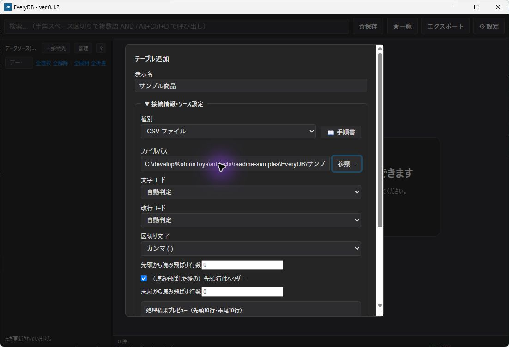
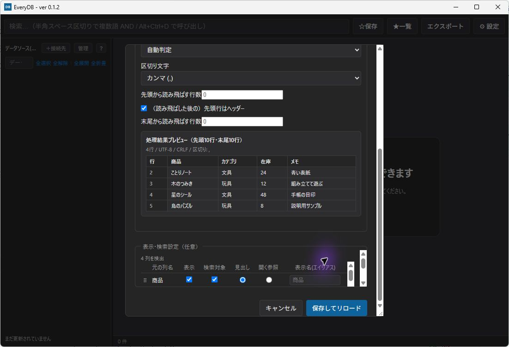
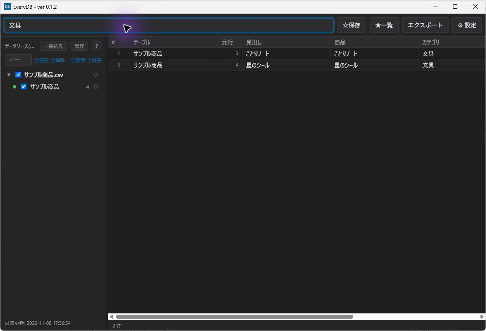
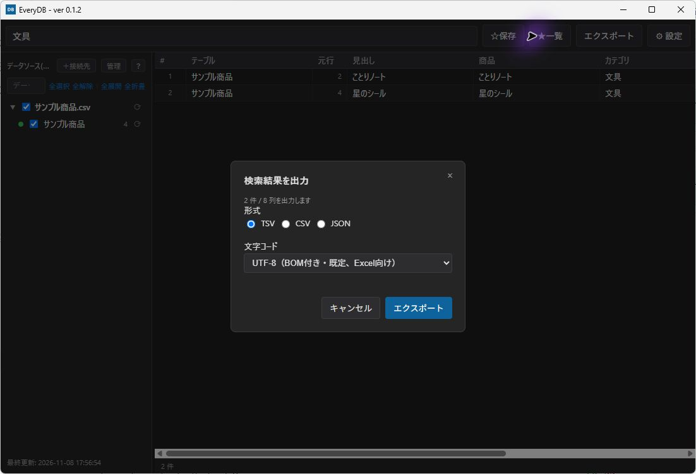
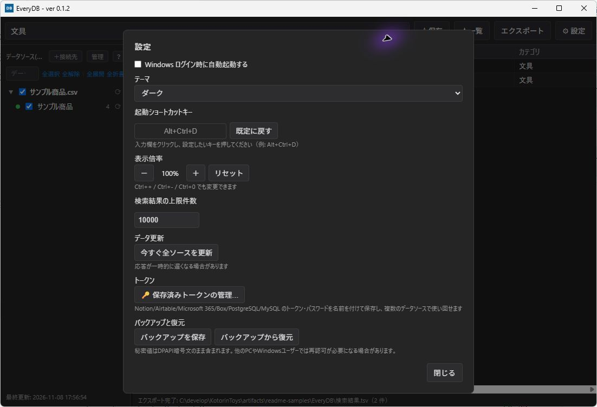

# EveryDB

EveryDB は、複数のデータソースをローカルの SQLite キャッシュへ取り込み、ひとつの画面から横断検索する Windows 向けデスクトップアプリです。データは接続のたびに検索するのではなく、明示または定期的な更新時にキャッシュします。

詳細な操作は [使い方](docs/user-guide.md)、接続先ごとの準備は [データソース一覧と接続手順](docs/data-sources.md)、問題の切り分けは [トラブルシューティング](docs/troubleshooting.md) を参照してください。

## 対応環境

- 共通インストーラー: Windows 11 x64、Microsoft Edge WebView2 Runtime
- ローカルファイル、Microsoft 365、各クラウドサービスなど、接続先に必要な権限・認証情報

## インストール

1. [GitHub Releases](https://github.com/KotorinChunChun/EveryDB/releases) から `EveryDB-0.1.1-setup.exe` を取得し、実行します。
2. 画面の案内に従ってインストールを完了します。KotorinToys 0.1.5以降の一覧からも導入・更新・削除できます。旧0.1.0のMSI／NSISは別の製品登録です。旧版を終了してWindowsのアプリ設定から削除し、共通版を導入してください。保存済みDBは共通で利用します。
3. EveryDB を起動し、サイドバーの「追加」からデータソースを登録します。

初回登録時に外部サービスへ送信される情報は、選んだデータソースとその接続設定だけです。認証方法や注意点は [プライバシーとセキュリティ](docs/security.md) を確認してください。

v0.1.1 の配布物にはコード署名がありません。Windows Defender SmartScreen の警告が表示される場合は、配布元と [GitHub Releases](https://github.com/KotorinChunChun/EveryDB/releases) に配布物と一緒に掲載するSHA-256を確認したうえで実行してください。コード署名は今後のリリースで対応予定です。

## アンインストール

Windows の「設定」→「アプリ」から EveryDB をアンインストールできます。

キャッシュと接続設定は `%APPDATA%\com.everydb.app\cache.db` にあります。アンインストール前に残したい場合はこのファイルをバックアップしてください。完全に消去したい場合だけ、アンインストール後にこのファイルを手動で削除してください。

## 画像で見る使い方

以下は0.1.2の画面です。説明用の架空の商品CSVを使っています。

### 1. 起動して接続先を追加する

初回は空の一覧が開きます。「接続先を追加」から取り込みたい種類を選びます。既に登録済みの場合は左上の「＋接続先」を使います。

### 2. 取り込み条件を指定する

CSVの例では、表示名、ファイルパス、文字コード、区切り文字、見出し行を指定します。外部サービスの場合は、その接続先に必要な設定を入力します。

### 3. プレビューして保存する

表示された列とデータを確認し、「保存してリロード」を押します。「表示・検索設定」で検索対象や列の表示も選べます。取得結果はローカルに保存されます。

### 4. キーワードで絞り込む

上部の検索欄に入力します。半角空白で複数語を区切ると、すべての語を含む結果へ絞れます。左側のチェックで検索するデータソースを選びます。

### 5. 結果を書き出す

「エクスポート」で、現在の検索結果をTSV・CSV・JSONへ保存できます。Excelで開く場合は、文字コードの「UTF-8（BOM付き）」が選べます。保存先は次のダイアログで指定します。

### 6. 表示やバックアップを設定する

右上の「設定」からテーマ・ショートカット・表示倍率を調整できます。保存済みトークンの管理、バックアップの保存・復元もここから開きます。自動起動をKotorinToysで管理する場合は、単体側と重複登録しないでください。

各ソースの更新ボタンで再取得し、「管理」から更新間隔や名前・列を編集できます。保存済み認証情報とWindows Helloの扱いは[使い方](docs/user-guide.md)を参照してください。

## 対応データソース

現在は35種類をサポートしています。

- ローカル: CSV、SQLite、Access、Excel（テーブル／範囲／シート一覧）、フォルダ、IME辞書、ブラウザ履歴・ブックマーク・ダウンロード履歴
- Microsoft 365: Entra ID、Teams、SharePoint、Intune、ライセンス、Outlook予定表、OneDrive、Planner
- クラウド・DB: Notion、Airtable、Google スプレッドシート、iCal、Box、PostgreSQL、MySQL
- 公開・Web: 郵便番号、法人番号、Webページ／JSON API、PokéAPI

認証方式、必要な設定、ライブ検証状況は [データソース一覧と接続手順](docs/data-sources.md) にまとめています。

## プライバシーとセキュリティ

- 検索対象のレコードはローカル SQLite キャッシュに保存されます。
- 秘密情報は Windows の DPAPI で保護して保存します。秘密値の表示では Windows Hello による確認を利用します。
- 接続先へ送信される情報は、そのデータソースの取得に必要な認証情報・URL・クエリ等に限られます。
- クラウドサービスを使用したことによる情報流出や、その後の利用に関する制限は、利用者の責任において管理してください。

保存場所、認証情報の扱い、注意事項は [セキュリティ](docs/security.md) を参照してください。

## 利用条件

本ツールはフリーウェアです。無制限にご利用頂けます。

ソースコードの公開範囲と利用条件は [利用条件](LICENSE.md) を確認してください。

クラウドサービスを使用したことによる情報流出や、その後の利用に関する制限は、利用者の責任において管理されるものとします。

本ツールを使用したことにより発生したいかなる損害も作者は責任を負いません。

バグや追加して欲しい機能などがあれば、GitHubのIssuesやTwitterなどでお声掛けください。

## 作者

**ことりちゅん** ([@KotorinChunChun](https://github.com/KotorinChunChun))

## 開発者向け文書

- [開発者ガイド](docs/DEVELOPERS_GUIDE.md)
- [ビルド方法](docs/development/building.md)
- [開発用秘密情報の保管](docs/development/secrets.md)
- [KotorinToysとの連携](docs/kotorintoys-integration.md)
- [テスト方法](docs/development/testing.md)
- [アーキテクチャ](docs/development/architecture.md)
- [データソース追加手順](docs/development/adding-a-data-source.md)
