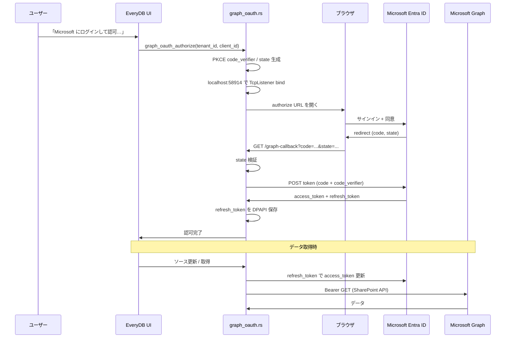

# Microsoft Graph 委任 OAuth 実装計画

## 背景

本計画の開始時点では、EveryDB の Microsoft Graph 連携は `src-tauri/src/graph.rs` の `GraphClient::new` が
**クライアントクレデンシャルフロー**（`grant_type=client_credentials`、スコープ
`https://graph.microsoft.com/.default`）のみをサポートしている。認証情報は
`credentials.rs` の `graph` スコープに **テナント ID・クライアント ID・クライアントシークレット**
を DPAPI 暗号化して保存し、接続設定から参照する。

SharePoint リスト / ドキュメントライブラリを含む Graph 系データソースは、
アプリケーション権限 **`Sites.Read.All`** が必要である（[Microsoft 365 手順書](../guides/microsoft365.md) 参照）。
アプリケーション権限はテナント管理者の同意が必須であり、SharePoint サイトへのアクセス範囲も
テナント全体に及ぶため、**ログインしたユーザー自身の権限に限定した取得**という UX が求められる。

Box 連携では `src-tauri/src/box_oauth.rs` により、OAuth 2.0 ブラウザ認可（ループバック
redirect + 固定ポート）と Client Credentials Grant の **認証方式切り替え**が既に実装済みである。
Graph でも同様の二系統共存を目指す。

## 目標 UX

トークン管理画面で組織用の Microsoft Entra ID（組織）プロファイルを作成する際、認証方式として
**「委任 OAuth（ユーザーにログインして認可）」** を選べるようにする。

- Box の **「🔗 Box にログインして認可…」** と同様に、**「Microsoft にログインして認可…」**
  ボタンで既定ブラウザを開き、Entra ID でサインイン・同意後に EveryDB へ自動復帰する。
- 認可完了後は **「✅ 認可済み」** を表示し、リフレッシュトークンを DPAPI で保存する。
- 既存の **クライアントシークレット / アプリケーション権限** 方式はそのまま残し、
  `auth_method` で切り替える。

## 固定設計判断

| 項目 | 決定内容 |
| :--- | :--- |
| 認可フロー | **Authorization Code + ループバック redirect + PKCE 必須**（Device Code Flow は使わない） |
| アプリ種別 | **パブリッククライアント**（クライアントシークレットなし）。v1 では **テナントごとに独自の Entra アプリ登録**（EveryDB 組み込みのマルチテナント `client_id` は持たない） |
| 既存方式 | クライアントシークレット + `client_credentials` は **維持**。credential manager が `auth_method` で分岐 |
| Phase 1 対象 | **SharePoint リスト / ドキュメントライブラリ** の委任 OAuth パス |
| Phase 2 以降 | その他 Graph 種別（Entra ID ユーザー、OneDrive、Outlook 予定表 等） |
| 委任権限（SharePoint / Teams ピッカー） | **`Sites.Read.All`（委任）**、**`Team.ReadBasic.All`（委任）**、**`offline_access`**、**`User.Read`**。将来 **`Sites.Selected`** による最小権限化を検討 |
| Redirect URI | Box と同様の **固定ポート + 専用パス**（後述） |

### 計画定数: Redirect URI

Box が `http://localhost:58913/box-callback` を使用しているため、Graph 用には別ポートを割り当てる。

```
http://localhost:58914/graph-callback
```

- 定数例: `REDIRECT_PORT = 58914`、`REDIRECT_PATH = "/graph-callback"`
- Entra アプリ登録・手順書・モジュール内 `REDIRECT_URI` は **1 文字も変えずに一致** させる。

## 参考実装

| ファイル | 参照する点 |
| :--- | :--- |
| `src-tauri/src/box_oauth.rs` | 固定ループバック redirect、`authorize_interactive`、`wait_for_callback`、取消/タイムアウト、`AtomicBool` によるキャンセル、単体テスト |
| `src-tauri/src/graph.rs` | 現行 `GraphClient`、ページネーション、`parse_site_url` |
| `src-tauri/src/credentials.rs` | `box` の `auth_method` / `refresh_token`（DPAPI）/ `resolve_config` でのトークン解決パターン |

## 実装結果（v0.0.6）

本計画の Phase 1 と、Phase 2 のうち本人用 Outlook 予定表・OneDrive を実装した。
委任資格情報は capability ごとに権限を選択し、データソースとの互換性を UI、保存、実行の各境界で検証する。

| capability | 委任されたアクセス許可 | 実行時の取得先 |
| :--- | :--- | :--- |
| `sharepoint` | `Sites.Read.All`, `Team.ReadBasic.All` | SharePoint API、Teams 選択は `/me/joinedTeams` |
| `calendar_self` | `Calendars.ReadBasic` | `/me/events` |
| `onedrive_self` | `Files.Read` | `/me/drive` |

全 capability の共通権限は `User.Read` と `offline_access`。app-only は従来の endpoint と UPN 指定を維持する。
`auth_method` が無い既存資格情報は app-only、capability が無い既存 delegated 資格情報は
`sharepoint` として扱い、DB schema migration は行わない。

### 個人 Microsoft アカウントの追加設計

組織向けの既存 `graph` 資格情報と `graph_onedrive` データソースは、内部 ID、保存形式、
app-only / delegated 分岐、UPN と `/me/drive` の実行ロジックを変更せず維持する。表示名だけを
**Microsoft Entra ID（組織）**、**OneDrive（組織）**へ明確化した。

個人 Microsoft アカウントは既存分岐へ追加せず、次の専用境界として実装した。

| 領域 | 個人向けの実装 |
| :--- | :--- |
| 資格情報 scope | `microsoft_account`。利用者入力のクライアント ID は持たず、秘密値はDPAPI保護したリフレッシュトークン |
| OAuth | Authorization Code + PKCE、authority `consumers`、`Files.Read User.Read offline_access` 固定 |
| データソース | `microsoft_account_onedrive`（OneDrive（個人））。対象UPNを持たず常に `/me/drive` |
| 互換性境界 | manifestのcredential scope、保存検証、実行時解決で組織用と相互利用を拒否 |
| 後方互換 | 新規テーブルやDB schema migrationは追加せず、既存組織用レコードをそのまま利用 |

この分離により、Personal OneDrive対応が既存の組織向け認証・コネクタの回帰要因にならない構造とした。
個人用OAuthのクライアントIDはEveryDBの本番用パブリッククライアントをバックエンドへ固定し、
利用者画面・資格情報レコード・IPC引数には露出させない。固定IDはauthorizeとrefreshで共通利用し、
旧資格情報に別の `client_id` が保存されている場合はネットワーク要求前に再認可を案内する。
固定IDで再認可して同じレコードを更新できるため、接続の付け替えやDB migrationは不要である。

## モジュール構成

### 新規: `src-tauri/src/graph_oauth.rs`

Box の `box_oauth.rs` をベースに、Microsoft 固有の差分を実装する。

- **PKCE**: `code_verifier` / `code_challenge`（S256）を生成し、authorize URL と token 交換に付与
- **Authorize URL**: `https://login.microsoftonline.com/{tenant_id}/oauth2/v2.0/authorize`
  - `response_type=code`
  - `scope`: 選択した capability から組み立てる最小権限 + `offline_access User.Read`（スペース区切り）
  - `redirect_uri`, `client_id`, `state`, `code_challenge`, `code_challenge_method=S256`
- **Token URL**: `https://login.microsoftonline.com/{tenant_id}/oauth2/v2.0/token`
  - Authorization Code 交換: `grant_type=authorization_code`, `code`, `redirect_uri`, `client_id`, `code_verifier`（**client_secret なし**）
  - Refresh: `grant_type=refresh_token`, `refresh_token`, `client_id`, `scope`（同上）
- **ループバック待受**: ポート `58914`、パス `/graph-callback`
- **公開定数**: `pub const REDIRECT_URI: &str = "http://localhost:58914/graph-callback";`

### 既存モジュールの拡張

#### `credentials.rs`（`graph` スコープ）

| フィールド | 公開/秘密 | 備考 |
| :--- | :--- | :--- |
| `tenant_id` | 公開 | 既存と同様 |
| `client_id` | 公開 | 既存と同様 |
| `client_secret` | 秘密（DPAPI） | `auth_method=app_only`（名称は実装時に確定）のときのみ |
| `auth_method` | 公開 | `"delegated"` / `"app_only"`（既定は後方互換のため `"app_only"`） |
| `capabilities` | 公開 | delegated で認可する機能。欠損時は後方互換のため `sharepoint` |
| `refresh_token` | 秘密（DPAPI） | `auth_method=delegated` のとき必須 |

- `protected_keys_of_scope("graph")` を `client_secret` に加え **`refresh_token`** を追加
- `resolve_config` に `graph` 分岐を追加: 委任時は refresh で access token をその場取得（Box と同様）
- `graph_access_token_for_credential(conn, id, fields_json)` を新設

#### `graph.rs`

- `GraphClient::new_with_token(access_token: &str)` 等、既存トークンを受け取るコンストラクタを追加
- 委任フローでは `client_credentials` 経路を使わない

#### コネクタ / IPC

- SharePoint コネクタは解決済み access token で `GraphClient` を構築
- Tauri コマンド: `graph_oauth_authorize`（Box の `box_oauth_authorize` 相当）
  - 引数: `credential_id` または `tenant_id` + `client_id`
  - 戻り: 成功時に `refresh_token` を credential へ保存

## 認可フロー（シーケンス）



## 実装フェーズ

### Phase 1: SharePoint 委任 OAuth（本計画の主対象）

1. `graph_oauth.rs` 新規作成（PKCE + ループバック + refresh）
2. `credentials.rs` の `graph` スコープ拡張（`auth_method`, `refresh_token`）
3. SharePoint コネクタのトークン解決を `resolve_config` 経由に統一
4. フロント: トークン管理 UI（認証方式ラジオ、認可ボタン、取消、認可状態表示）
5. `docs/guides/microsoft365-delegated.md` を `GUIDE_FOR_TYPE` / `shared/source-types.json` に紐付け（SharePoint 種別）
6. 単体テスト + `#[ignore]` ライブテスト

### Phase 2: その他 Graph 種別への委任 OAuth 拡張

- Outlook 予定表は `calendar_self` + `/me/events`、OneDrive は `onedrive_self` + `/me/drive` を実装済み
- manifest に認証方式・必要 capability を宣言し、非対応資格情報は理由付きで選択不可にする
- Rust 側でもソース保存、資格情報更新、preview、reload、browse の各境界で同じ互換性を強制する
- Entra ID、Intune、ライセンス、Teams 一覧、Planner 等は app-only 専用を維持する

### Phase 2 追加: 個人 Microsoft アカウントの OneDrive

- `microsoft_account` 資格情報と `microsoft_account_onedrive` を組織向けIDから分離
- `consumers` authority と `Files.Read User.Read offline_access` を authorize / refresh の両方で固定
- 個人用コネクタは `/me/drive` の読み取り専用再帰取得だけを提供
- 組織用 / 個人用の相互選択をUI、保存、実行の各境界で拒否
- ライブ検証は利用者の個人 Microsoft アカウント環境で後日実施

### Phase 3（任意）: マルチテナント公共アプリ

- EveryDB 公式のマルチテナント Entra アプリ + 固定 `client_id` を配布
- テナント側の app registration 手順を省略できる UX
- セキュリティレビュー・同意画面・サポートコストを要するため v1 スコープ外

## IPC / UI 変更（実装タスク一覧）

v0.0.6 で反映した項目:

| 領域 | タスク |
| :--- | :--- |
| トークン管理（credential manager） | Graph プロファイルに `auth_method` 選択 UI。委任時は client_secret 入力を非表示 |
| トークン管理 | 「Microsoft にログインして認可…」ボタン、取消ボタン、認可状態（✅ 認可済み） |
| トークン管理 | Redirect URI ヘルプ文言（`http://localhost:58914/graph-callback`） |
| 接続設定ピッカー | 委任プロファイル選択時も `cred:<id>` 参照で動作することを確認 |
| 接続設定ピッカー | 非対応プロファイルを理由付き disabled 表示し、選択を拒否 |
| 手順書リンク | `microsoft365.md`を方式比較メニューとし、`microsoft365-app-only.md`と`microsoft365-delegated.md`へ分離。credential managerは選択中の方式別ページを直接開く |
| Tauri IPC | `graph_oauth_authorize` コマンド、キャンセルフラグ、アプリ終了時の OAuth 待機打ち切り |

## テスト計画

Box の `box_oauth.rs` テスト構成を踏襲する。

### 単体 / モック

- `random_state` / PKCE `code_verifier` の長さ・エンコード
- `authorize_url` に `code_challenge`, `code_challenge_method`, `state`, `scope` が含まれること
- `REDIRECT_URI` と定数ポートの一致
- `parse_query` / コールバック handler の state 不一致拒否
- `urlencode` 相当のエスケープ

### 結合（HTTP モック）

- トークンエンドポイントへの form POST パラメータ検証（PKCE、`client_secret` 無し）
- refresh 時の scope 指定

### ライブ（`#[ignore]`）

- 実テナント + テスト用 Entra アプリでの end-to-end 認可（CI では実行しない）
- SharePoint サイト、Teams 選択、本人の Outlook 予定表、本人の OneDrive の smoke test
- 個人 Microsoft アカウントでの認可とOneDrive（個人）の初回取得・再リロード
- v0.0.6 実装時のライブ検証はユーザーが後日実施するため、自動品質ゲートとは分けて記録する

### ライフサイクル（Box と同様）

| ケース | 期待動作 |
| :--- | :--- |
| ユーザーが認可 UI で **取消** | 「Microsoft の認可をキャンセルしました」等。トークン未保存 |
| **タイムアウト**（例: 180 秒） | エラー表示。トークン未保存 |
| **アプリ終了**（ウィンドウ / トレイ） | 進行中 OAuth 待機を自動取消 |
| ループバックポート **競合** | 「ポート 58914 を確保できませんでした」と明示 |

## リスクと対策

| リスク | 内容 | 対策 |
| :--- | :--- | :--- |
| 管理者同意 | `Sites.Read.All`（委任）も組織ポリシーによっては **管理者同意が必要** | 手順書に同意手順を記載。エラー `AADSTS65001` 等をよくあるエラー表に追加 |
| トークン失効 | refresh token の失効、パスワード変更、条件付きアクセス | 「再認可を促す」メッセージ。Box と同様の UX |
| app-only との共存 | 同一 `graph` スコープ内で方式混在 | `auth_method` を必須分岐。既存プロファイルは `app_only` 既定で後方互換 |
| PKCE 必須化 | Entra のパブリッククライアントは PKCE 推奨/必須 | v1 から PKCE 実装。Device Code は採用しない |
| ポート固定 | 58914 が他プロセスで使用中 | bind 失敗時に明確なエラー（Box と同パターン） |
| 権限の広さ | `Sites.Read.All` はユーザーがアクセス可能な全サイト | Phase 3 以降で `Sites.Selected` + サイト単位付与を検討 |

## v1 の非目標

- Device Code Flow
- EveryDB 組み込みマルチテナント `client_id` の配布（Phase 3）
- クライアントシークレットを使う委任フロー（コンフィデンシャルクライアント）
- Planner / Teams タスク、Entra ID、Intune、ライセンス、Teams チーム一覧の委任 OAuth
- Outlook / OneDrive で本人以外のユーザーを委任 OAuth から指定すること
- `/me/joinedTeams` に共有チャネルのホスト Team を補完すること
- `Sites.Selected` による最小権限構成（将来検討）
- バックグラウンドでのサイレント SSO（ブラウザセッション再利用の最適化）

## 関連ドキュメント

- エンドユーザー手順: [Microsoft 365 委任 OAuth 手順書](../guides/microsoft365-delegated.md)
- 認証方式の比較: [Microsoft Graph 接続方法の選択](../guides/microsoft365.md)
- app-only 手順: [Microsoft 365 アプリケーション認証手順書](../guides/microsoft365-app-only.md)
- 個人向け手順: [OneDrive（個人）の接続手順](../guides/microsoft365-personal.md)
- Box OAuth 参考: [Box 手順書](../guides/box.md)
