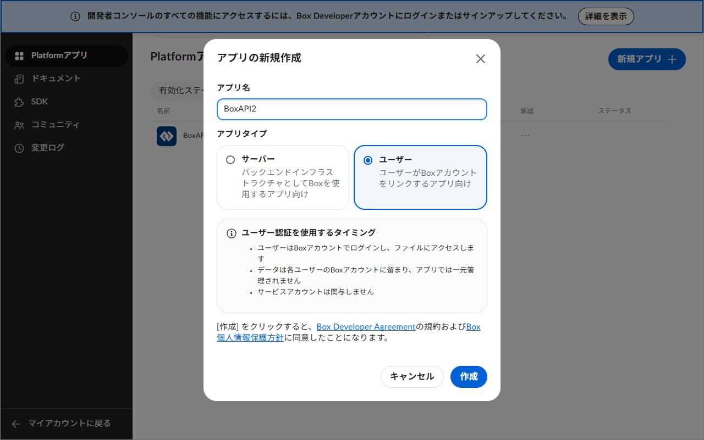

# Box（ファイル一覧）の接続手順

対象の EveryDB 種別: **Box (ファイル一覧)**

## 概要

EveryDB は Box への認証方式として次の2つを選べます。トークン管理画面の「認証方式」で切り替えます。

- **個人プラン（OAuth 2.0 ブラウザ認可）**: 自分の Box アカウントでログイン・認可します。
  個人（無料）プランはこちらのみ対応です。
- **法人/Enterpriseプラン（Client Credentials Grant）**: サービスアカウントとして認証します。
  Enterprise 管理者による**アプリの承認**と **Enterprise ID** が必要です。

個人プランで **Client Credentials Grant（サーバー認証）は利用できません**
（`unauthorized_client` / `box_subject_type` のエラーになります）。まずは「個人プラン」を選んでください。

## 個人プラン（OAuth 2.0）の手順

### 事前に必要なもの

- Box アカウント（個人プランで構いません）

### 手順

1. トークン管理画面の **🔑 取得…** を押して [Box Developer Console](https://app.box.com/developers/console) を開きます。
2. **アプリの新規作成** → **カスタムアプリ** を選び、認証方式に **ユーザー認証（標準 OAuth 2.0）**
   を選んで作成します（**サーバー認証（クライアント資格情報許可）は個人プランでは選べません／
   選んでも使えません**）。
   
3. 作成したアプリの **構成** タブで次を設定します。
   - **OAuth 2.0 Redirect URI（リダイレクト URI）** に、次の値を**1文字も変えずに**追加します。

     ```
     http://localhost:58913/box-callback
     ```

     （EveryDB がブラウザ認可の応答を受け取るために内部で使う固定のポート番号です。ここが
     1文字でも違うと `redirect_uri_mismatch` エラーになります。）

   - **アプリケーションスコープ**: 「Box に格納されているすべてのファイルとフォルダの読み取り」を有効化

4. 同じ画面の **OAuth 2.0 資格情報** から **クライアント ID** と **クライアント シークレット** をコピーします。
5. EveryDB のトークン管理画面で Box のプロファイルを新規作成し、認証方式で
   **「個人プラン（OAuth 2.0 ブラウザ認可）」** を選んだうえで、手順 4 のクライアント ID・
   クライアントシークレットを入力し、**🔗 Box にログインして認可…** を押します。
   既定のブラウザが開くので、Box にログインして許可すると自動的に EveryDB へ戻ります
   （ブラウザのタブは閉じて構いません）。
6. 「✅ 認可済み」の表示を確認して保存します。

認可すると得られる「リフレッシュトークン」は Box の仕様上、使うたびに新しいものへ自動的に
更新（ローテーション）されます。EveryDB が更新のたびに保存し直すので、通常は再認可の操作は
不要です。ただし60日以上使わずに放置すると失効するため、その場合はもう一度手順5の認可をやり直してください。

## 法人/Enterpriseプラン（Client Credentials Grant）の手順

### 事前に必要なもの

- Box の開発者アカウントと、企業（Enterprise）の管理者による承認
- Enterprise ID（Box **管理コンソール**の「アカウントと請求」で確認できます。
  API 用の Developer Console とは別画面です）

### 手順

1. Box Developer Console で **アプリの新規作成** → **カスタムアプリ** → 認証方式に
   **サーバー認証（クライアント資格情報許可）** を選んで作成します。
2. **構成** タブで、**アプリケーションスコープ**（すべてのファイル/フォルダの読み取り）と
   **アプリアクセスレベル**（「アプリ + Enterprise アクセス」）を設定します。
3. **クライアント ID** と **クライアント シークレット** をコピーします。
4. **承認** タブで **アプリの承認を申請** を押し、Box 管理者に承認してもらいます
   （管理者は管理コンソールの「アプリ」→「カスタムアプリマネージャー」で承認）。
   **承認前は認証に失敗します。**
5. EveryDB のトークン管理画面で認証方式を **「法人/Enterpriseプラン（Client Credentials Grant）」**
   に切り替え、クライアント ID・クライアントシークレット・Enterprise ID を入力して保存します。

## EveryDB 側の入力項目

| 項目                                   | 入力する値                          | 備考                                                       |
| :------------------------------------- | :---------------------------------- | :--------------------------------------------------------- |
| 認証方式                               | 個人プラン or 法人/Enterpriseプラン | どちらか選ぶと残りの項目が切り替わります                   |
| クライアントID                         | Developer Console の Client ID      |                                                            |
| クライアントシークレット               | Developer Console の Client Secret  | 暗号化して保存されます                                     |
| Box アカウントの認可（個人プランのみ） | （手動入力しません）                | 「ログインして認可」ボタンでブラウザ認可した結果が入ります |
| Enterprise ID（法人プランのみ）        | 企業アカウントの ID（数字）         | 管理コンソールの「アカウントと請求」で確認                 |
| 開始フォルダID(任意)                   | 走査を開始するフォルダ ID           | 空欄なら`0`（ルート）。接続先ごとに設定できます            |

フォルダ ID は、Box でフォルダを開いたときの URL `https://app.box.com/folder/123456789` の数字部分です。

## よくあるエラーと対処

| 症状                                                       | 原因                                                                                                               | 対処                                                                                                                 |
| :--------------------------------------------------------- | :----------------------------------------------------------------------------------------------------------------- | :------------------------------------------------------------------------------------------------------------------- |
| `unauthorized_client` / `box_subject_type` に関するエラー  | 個人プランで法人/Enterpriseプラン（CCG）を選んでいる                                                               | 認証方式を「個人プラン（OAuth 2.0）」に変更する                                                                      |
| ブラウザに`redirect_uri_mismatch` と表示される             | Redirect URI の未登録・入力ミス                                                                                    | Developer Console の Redirect URI が`http://localhost:58913/box-callback` と完全一致しているか確認（ポート番号込み） |
| `Box トークン取得失敗 401`                                 | Client ID / Secret の誤り                                                                                          | 貼り直す                                                                                                             |
| 認可後に `invalid_client` / `The client credentials are invalid` | クライアントシークレットが誤って登録されている（新規作成時の入力ミス、またはコンソール側でシークレットを再発行した後に貼り直していない） | 正しいクライアントシークレットを Developer Console からコピーし直して入力する |
| 「Box の認可が完了していません」                           | まだ認可を行っていない、または認可情報が失効した                                                                   | トークン管理画面で対象プロファイルを開き、認可をやり直す                                                             |
| `403 access_denied_insufficient_permissions`（法人プラン） | アプリが未承認・スコープ不足                                                                                       | 法人プラン手順の 2・4 を実施                                                                                         |
| 0 件                                                       | 開始フォルダを間違えている、または該当フォルダにファイルが無い（法人プランではサービスアカウントに未共有の場合も） | 開始フォルダIDを確認、法人プランは対象フォルダをサービスアカウントに共有する                                         |

## 参考リンク

- [Box Developer Console](https://app.box.com/developers/console)
- [Box OAuth 2.0 セットアップガイド](https://developer.box.com/guides/authentication/oauth2/oauth2-setup/)
- [Client Credentials Grant](https://developer.box.com/guides/authentication/client-credentials/)
